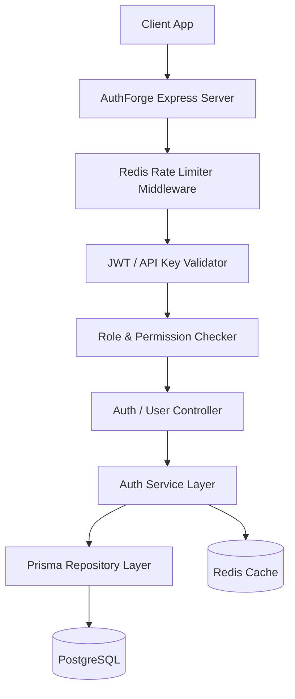

# AuthForge - Deep Dive & Technical Architecture Specification

## 1. Project Overview
AuthForge is an enterprise-grade, centralized Authentication, Authorization, and API Gateway platform built with Node.js, Express, TypeScript, Prisma ORM, PostgreSQL, and Redis. It acts as an identity provider and security ingress proxy for microservices.

### Interview Explanations
- **30-Second Pitch**: "AuthForge is a centralized identity and security gateway microservice architecture built with TypeScript, Express, Prisma, PostgreSQL, and Redis. It manages user registration, argon2id password hashing, JWT access tokens, 256-bit refresh token rotation with reuse detection, granular RBAC, and dynamic API gateway routing."
- **1-Minute Pitch**: "AuthForge serves as a unified authentication gateway for multi-tenant backend architectures. When requests hit the gateway, custom Express middleware checks sliding-window rate limits in Redis and validates JWT access tokens. If access is granted, the gateway dynamic proxy engine routes traffic to upstream microservices. User identities and append-only audit logs are persisted in PostgreSQL via Prisma ORM."
- **3-Minute Pitch**: "In AuthForge, I prioritized security, high availability, and strict type safety. Password hashes use Argon2id to resist GPU cracking. Tokens follow the OAuth 2.0 / JWT paradigm: short-lived 15-minute access tokens and long-lived 256-bit refresh tokens stored in PostgreSQL with family-id rotation. If a compromised or reused refresh token is presented, AuthForge revokes the entire token family automatically. Redis handles sub-millisecond session caching and IP sliding-window rate limiting. The API proxy uses `http-proxy-middleware` with custom permission checks."

## 2. Technology Stack
| Technology | Where Used | Why Used | Important Concepts |
|---|---|---|---|
| Node.js & TypeScript | Core Backend | Type safety, high async concurrency | Generics, strict interfaces, async/await |
| Express.js | API Router & Middleware | Flexible middleware pipeline | Middleware chain, error handler, req/res |
| Prisma ORM | Database Access Layer | Compile-time query safety & schema management | Migrations, type generation, relations |
| PostgreSQL | Data Persistence | ACID compliance for identity & auth records | Constraints, indexes, transactions |
| Redis | Caching & Rate Limiting | Sub-millisecond sliding-window counter | Atomic `INCR`/`EXPIRE`, hash maps, TTL |
| Argon2id / bcrypt | Password Hashing | Resistance against hardware/GPU side-channel attacks | Memory cost, time cost, parallelism |

## 3. Architecture & Data Flow

## 4. API Endpoint Reference
| Method | Endpoint | Auth | Purpose |
|---|---|---|---|
| `POST` | `/api/v1/auth/register` | None | User Registration |
| `POST` | `/api/v1/auth/login` | None | User Authentication & Token Generation |
| `POST` | `/api/v1/auth/refresh` | None | Refresh Token Rotation & Access Token Issuance |
| `POST` | `/api/v1/auth/logout` | JWT | Session Revocation |
| `GET` | `/api/v1/users/me` | JWT | Fetch Profile & Roles |

## 5. Security & Threat Model
- **Token Reuse Detection**: Refresh tokens are linked to a `familyId`. Presenting an already-rotated token invalidates all active tokens in that family.
- **Rate Limiting**: Sliding window counter stored in Redis keyed by IP address (`rate_limit:ip:<IP>`).
- **SQL Injection**: Prevented natively via Prisma ORM parameterized queries.

## 6. Interview QA & Cheat Sheet
- **Q**: How do you prevent token theft?
- **A**: By combining short access token lifespans (15m) with refresh token rotation and family-level token revocation upon reuse detection.
