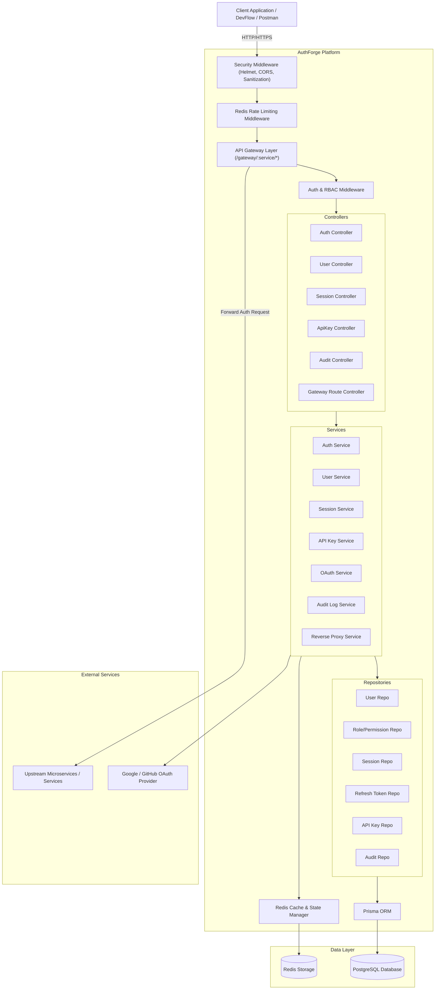
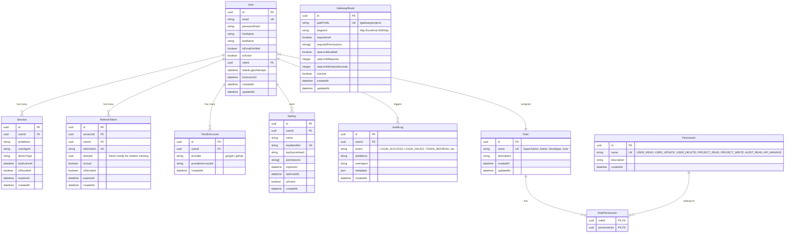

# AuthForge - Design & Architecture Specification

## 1. Architecture Summary
AuthForge is designed as a production-grade, centralized Authentication, Authorization, and API Gateway Platform built with **TypeScript**, **Node.js**, **Express**, **Prisma ORM**, **PostgreSQL**, and **Redis**.

It uses a **modular monolith** design pattern:
- **Centralized Identity & Access Management (IAM)**: Registration, multi-factor credential verification, JWT issuance, session tracking, OAuth integration, password lifecycle.
- **Refresh Token Rotation & Reuse Detection**: Cryptographically secure 256-bit refresh tokens with rotation and breach detection to prevent session hijacking.
- **Granular RBAC**: Role-Permission mapping with custom authorization middleware checking fine-grained permissions (`USER_READ`, `USER_DELETE`, `API_MANAGE`, etc.).
- **API Key Management**: Securely hashed API keys with scoped permissions, sliding window usage tracking, and rate limiting.
- **API Gateway Layer**: Dynamically proxies, authenticates, authorizes, rate-limits, and logs requests destined for upstream client microservices/applications.
- **Observability & Audit Engine**: Structured JSON logging (`winston`/`pino`) with correlation IDs (`req_id`), plus persistent append-only audit logging for security events.

---

## 2. Component Diagram



---

## 3. Database ER Design



---

## 4. Authentication Flow

### A. Registration & Verification
1. `POST /api/v1/auth/register` with `{ email, password, firstName, lastName }`.
2. Zod validates email format and strong password policy (min 8 chars, 1 uppercase, 1 lowercase, 1 number, 1 special char).
3. Check email uniqueness in PostgreSQL.
4. Hash password with **Argon2id** (or `bcrypt` with salt round 12).
5. Assign default role (`User`).
6. Create verification token hashed in Redis (`email:verify:{token}`) and send/log verification link.

### B. Login & Token Generation
1. `POST /api/v1/auth/login` with `{ email, password }`.
2. Rate-limited by IP via Redis (`rate:login:{ip}`, 5 attempts/min).
3. Validate credentials; check account lockout status (`lockoutUntil`).
4. On failure: increment `failedLoginAttempts`, log `LOGIN_FAILED` in audit log. Lock account for 15 minutes after 5 failures.
5. On success: reset failed attempts. Generate a new `Session` record in DB and Redis.
6. Generate Short-Lived Access Token (JWT, 15-minute expiry) containing `{ sub: userId, role: roleName, sid: sessionId }`.
7. Generate Long-Lived Refresh Token (random 256-bit entropy, 7-day expiry). Hash token before saving into `RefreshToken` table with a unique `familyId`.
8. Set Refresh Token in an `httpOnly`, `SameSite=Strict`, `Secure` cookie (or response payload for client API usage). Return Access Token and session summary.

### C. Refresh Token Rotation & Reuse Detection
1. `POST /api/v1/auth/refresh`.
2. Client sends refresh token cookie or header.
3. Compute SHA-256 hash of incoming token and lookup in DB.
4. **Reuse Detection Check**:
   - If token is found and `isUsed === true` or `isRevoked === true`:
     - **SECURITY ALERT**: Token reuse detected! Invalidate **ALL** refresh tokens and sessions belonging to that `familyId`.
     - Log `SECURITY_ALERT_REFRESH_TOKEN_REUSE` audit event.
     - Return `401 Unauthorized` with `TOKEN_REUSED` error code.
5. If token is valid and un-used:
   - Mark old token `isUsed = true`.
   - Issue new Refresh Token attached to the same `familyId`.
   - Issue new short-lived JWT Access Token.
   - Update `Session.lastActiveAt` in DB & Redis.

---

## 5. Authorization Model (RBAC)

AuthForge implements strict Role-Based Access Control mapped to atomic Permissions:

| Role | Default Permissions |
|---|---|
| **SuperAdmin** | `USER_READ`, `USER_UPDATE`, `USER_DELETE`, `PROJECT_READ`, `PROJECT_WRITE`, `AUDIT_READ`, `API_MANAGE`, `GATEWAY_MANAGE`, `ROLE_MANAGE` |
| **Admin** | `USER_READ`, `USER_UPDATE`, `PROJECT_READ`, `PROJECT_WRITE`, `AUDIT_READ`, `API_MANAGE` |
| **Developer** | `PROJECT_READ`, `PROJECT_WRITE`, `API_MANAGE` |
| **User** | `PROJECT_READ` |

---

## 6. API Specification Overview

### Authentication (`/api/v1/auth`)
- `POST /api/v1/auth/register` - User registration
- `POST /api/v1/auth/verify-email` - Verify email token
- `POST /api/v1/auth/login` - User login
- `POST /api/v1/auth/refresh` - Refresh access token
- `POST /api/v1/auth/logout` - Revoke current session
- `POST /api/v1/auth/logout-all` - Revoke all user sessions
- `POST /api/v1/auth/forgot-password` - Trigger reset email token
- `POST /api/v1/auth/reset-password` - Reset password using token

### OAuth (`/api/v1/auth/oauth`)
- `GET /api/v1/auth/oauth/google` - Initiate Google OAuth
- `GET /api/v1/auth/oauth/google/callback` - OAuth Callback
- `GET /api/v1/auth/oauth/github` - Initiate GitHub OAuth
- `GET /api/v1/auth/oauth/github/callback` - OAuth Callback

### User & Profile (`/api/v1/users`)
- `GET /api/v1/users/me` - Get current user profile
- `PATCH /api/v1/users/me` - Update profile details
- `PATCH /api/v1/users/me/change-password` - Change current password
- `GET /api/v1/users` - Admin list/search users
- `PATCH /api/v1/users/:id/status` - Enable/Disable user account
- `PATCH /api/v1/users/:id/role` - Assign new user role

### Session Management (`/api/v1/sessions`)
- `GET /api/v1/sessions` - List active user sessions
- `DELETE /api/v1/sessions/:id` - Revoke specific session

### API Keys (`/api/v1/api-keys`)
- `GET /api/v1/api-keys` - List user API keys
- `POST /api/v1/api-keys` - Create new API key (Secret shown once)
- `DELETE /api/v1/api-keys/:id` - Revoke API key

### Audit Logs (`/api/v1/audit-logs`)
- `GET /api/v1/audit-logs` - Query security audit logs with pagination & filters

### API Gateway (`/gateway/:service/*`)
- Dynamic proxying to downstream registered services with authentication, RBAC permission verification, and rate limiting.

---

## 7. Redis Key Design

| Key Pattern | Data Type | Purpose | TTL |
|---|---|---|---|
| `auth:session:{sessionId}` | Hash | Cached active session info | 7 days |
| `rate:login:{ip}` | String / Counter | IP Rate Limiting for Login | 60 sec |
| `rate:api:{userId}` | String / Counter | User Rate Limiting for API | 60 sec |
| `rate:key:{keyId}` | String / Counter | Rate limit per API Key | 60 sec |
| `rate:gateway:{ip}` | String / Counter | Gateway Rate Limit per IP | 60 sec |
| `token:blacklist:{jti}` | String | Blacklisted Access Tokens | Token remaining exp |
| `auth:reset:{tokenHash}` | String | Password Reset Token -> userId | 15 min |
| `auth:verify:{tokenHash}` | String | Email Verification Token -> userId | 24 hours |

---

## 8. Directory Structure

```
AuthForge/
├── .github/
│   └── workflows/
│       └── ci.yml
├── docs/
│   ├── architecture.md
│   ├── authentication.md
│   ├── authorization.md
│   ├── security.md
│   ├── database.md
│   ├── api.md
│   └── gateway.md
├── prisma/
│   ├── schema.prisma
│   └── seed.ts
├── src/
│   ├── config/          # Environment variables & constants
│   ├── controllers/     # Request handlers
│   ├── middleware/      # Auth, RBAC, Rate Limit, Error, Request ID
│   ├── routes/          # Express route definitions
│   ├── services/        # Core business logic
│   ├── repositories/    # Database queries & Prisma abstraction
│   ├── validators/      # Zod validation schemas
│   ├── auth/            # JWT, Argon2/Bcrypt, Token generation
│   ├── security/        # Encryption, hashing helpers, sanitization
│   ├── gateway/         # Reverse proxy & dynamic route handler
│   ├── cache/           # Redis client & helper functions
│   ├── logging/         # Logger instance & HTTP logger middleware
│   ├── audit/           # Audit logger service & event constants
│   ├── utils/           # Helper functions & custom errors
│   ├── types/           # Express extensions & TypeScript types
│   ├── app.ts           # Express app setup
│   └── server.ts        # Server entry point
├── tests/
│   ├── integration/     # API endpoint tests with Supertest
│   └── unit/            # Service & Utility unit tests
├── docker-compose.yml
├── Dockerfile
├── package.json
├── tsconfig.json
└── README.md
```

---

## 9. Threat Model & Security Considerations

| Threat Category | Potential Attack Vector | AuthForge Mitigation |
|---|---|---|
| **Credential Stuffing / Brute Force** | Automated dictionary attacks against `/login` | Strict Redis rate limiting (5 attempts/min/IP) + Account lockout after 5 consecutive failed attempts. |
| **Token Theft & Replay** | Stolen Refresh Token used to generate access tokens | Refresh Token Rotation with Token Family tracking. Immediate revocation of all family tokens on reuse detection. |
| **XSS & Token Sniffing** | JavaScript accessing local storage tokens | Refresh Tokens placed in `httpOnly`, `SameSite=Strict`, `Secure` cookies. Access tokens short-lived (15m). |
| **Privilege Escalation** | Manipulating token payload or user requests to access admin APIs | Decoupled RBAC system with server-side permission verification (`requirePermission`). Roles fetched from DB/Redis session state. |
| **Secret Leakage** | API keys or raw passwords exposed in DB logs or Git | Passwords hashed using Argon2id/Bcrypt. API keys hashed via HMAC-SHA256 before storage. Never log credentials or tokens. |
| **Injection Attacks** | SQL/NoSQL Injection in user input | Prisma ORM uses parameterized queries exclusively. Input sanitized and validated using Zod. |
| **API Abuse & Denial of Service** | Flooding backend or upstream services | Distributed Redis sliding window rate limiters across IP, User ID, and API Key levels. |

---

## 10. Incremental Milestone Execution Plan

- **Milestone 1**: Project Setup, TypeScript setup, Docker Compose (Postgres + Redis), Prisma Schema & Migrations.
- **Milestone 2**: User Registration, Zod Validation, Argon2/Bcrypt Password Hashing, User Repository.
- **Milestone 3**: Login Flow, JWT Generation, Account Lockout Mechanism.
- **Milestone 4**: Refresh Token Rotation, Session Management, Logout & Logout-All features.
- **Milestone 5**: RBAC System, Roles & Permissions schema, Authorization Middleware (`requirePermission`).
- **Milestone 6**: OAuth 2.0 Integration (Google/GitHub provider verification flow).
- **Milestone 7**: API Key Management System (Key generation, hashing, verification, permission scoping).
- **Milestone 8**: Redis-based Rate Limiting Middleware (Custom sliding window counter for Auth, User, API Keys).
- **Milestone 9**: API Gateway Engine (Dynamic HTTP proxying to target upstream services with auth & permission checks).
- **Milestone 10**: Structured Logging (Winston, Request Correlation ID) & Audit Logging System.
- **Milestone 11**: Automated Testing Suite (Jest + Supertest integration & unit tests).
- **Milestone 12**: Dockerization & CI/CD Pipeline (GitHub Actions).
- **Milestone 13**: Portfolio Documentation, Swagger/OpenAPI docs, Admin Dashboard UI, Architecture guides.
